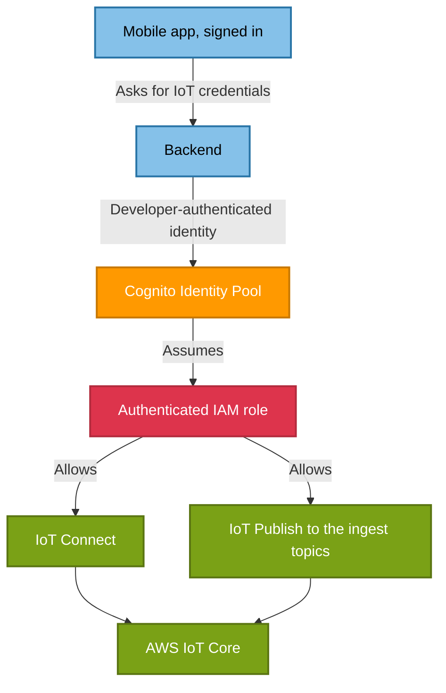

# 🔑 Cognito Module

This module creates the AWS Cognito Identity Pool through which the mobile app gets the credentials it publishes measurements to IoT Core with.

## 📖 Overview

The backend mints the credentials for a signed-in user through developer-authenticated identities: it asks the pool for a token for that user's identity, exchanges it for temporary credentials, and hands them to the app. Those credentials come from the authenticated role, which can connect to IoT Core and publish to the `experiment/data_ingest/v1` topics. Provisioned devices do not use the pool; they publish with their own certificates.

A client without a signed-in session gets no credentials. `allow_unauthenticated_identities` turns anonymous access back on, with its own role and the same publish permissions, and is off by default.



## 🛠 Resources Used

| Resource                                     | Description                                                        | Documentation                                                                                                                                                    |
| -------------------------------------------- | ------------------------------------------------------------------ | ---------------------------------------------------------------------------------------------------------------------------------------------------------------- |
| `aws_cognito_identity_pool`                  | Creates the Cognito Identity Pool the app's credentials come from  | [AWS Cognito Identity Pool](https://registry.terraform.io/providers/hashicorp/aws/latest/docs/resources/cognito_identity_pool)                                   |
| `aws_iam_role`                               | Creates the authenticated role, and the anonymous one when allowed | [AWS IAM Role](https://registry.terraform.io/providers/hashicorp/aws/latest/docs/resources/iam_role)                                                             |
| `aws_iam_policy`                             | Defines permissions for IoT device connections and publishing      | [AWS IAM Policy](https://registry.terraform.io/providers/hashicorp/aws/latest/docs/resources/iam_policy)                                                         |
| `aws_cognito_identity_pool_roles_attachment` | Attaches IAM roles to the Cognito Identity Pool                    | [AWS Cognito Identity Pool Roles Attachment](https://registry.terraform.io/providers/hashicorp/aws/latest/docs/resources/cognito_identity_pool_roles_attachment) |
| `aws_iam_role_policy_attachment`             | Attaches the IoT policy to the IAM role                            | [AWS IAM Role Policy Attachment](https://registry.terraform.io/providers/hashicorp/aws/latest/docs/resources/iam_role_policy_attachment)                         |

## ⚙️ Usage

```hcl
module "cognito" {
  source             = "../../modules/cognito"
  region             = var.aws_region
  environment        = var.environment
  identity_pool_name = "open-jii-${var.environment}-iot-identity-pool"
}
```

The backend reads the pool ID and the developer provider name from its configuration and mints credentials in `apps/backend/src/common/modules/aws/services/cognito/cognito.service.ts`.

## 🔑 Inputs

| Name                               | Description                                                                              | Type     | Default             | Required |
| ---------------------------------- | ---------------------------------------------------------------------------------------- | -------- | ------------------- | :------: |
| `identity_pool_name`               | Name for the Cognito Identity Pool                                                       | `string` | n/a                 |  ✅ Yes  |
| `environment`                      | Deployment environment, prefixed to the developer provider name                          | `string` | n/a                 |  ✅ Yes  |
| `region`                           | AWS region                                                                               | `string` | "eu-west-1"         |  ❌ No   |
| `developer_provider_name`          | Developer provider name for developer-authenticated identities                           | `string` | "login.openjii.com" |  ❌ No   |
| `allow_unauthenticated_identities` | Whether a client with no signed-in session can get IoT publish credentials from the pool | `bool`   | `false`             |  ❌ No   |

## 📤 Outputs

| Name                      | Description                                                         |
| ------------------------- | ------------------------------------------------------------------- |
| `identity_pool_id`        | The ID of the created Cognito Identity Pool                         |
| `identity_pool_arn`       | The ARN of the created Cognito Identity Pool                        |
| `authenticated_role_arn`  | ARN of the authenticated IAM role for developer-authenticated users |
| `developer_provider_name` | Developer provider name for API calls (environment-specific)        |
